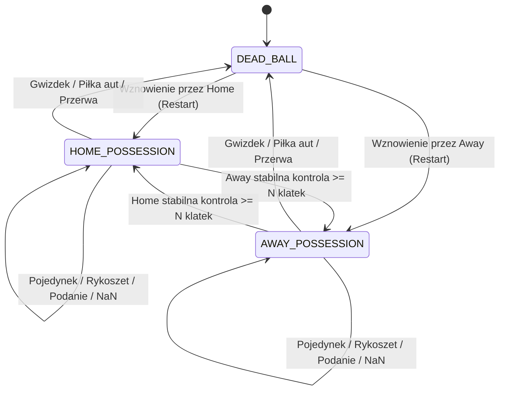

# Moduł: Logika Posiadania Piłki (`src/possession`)

Dokumentacja techniczna, kontekst projektu, standardy branżowe oraz specyfikacja reguł logicznych i algorytmicznych dla modułu **Logika Posiadania Piłki** w projekcie **AGH Data Team: More than a Hack 2027 (Phase 1)**.

---

## 1. Kontekst projektu i cel zadania

### 1.1. Zadanie konkursowe
Dla pełnego meczu piłkarskiego (**FC Barcelona vs Athletic Club**, LaLiga EA Sports 2024/25, 199 319 klatek przy 25 FPS, z czego 158 857 klatek to gra oceniana w dwóch połowach) należy wygenerować dla każdej klatki dokładnie jedną z czterech etykiet:
- **`H`** – piłka w grze, w posiadaniu drużyny gospodarzy (Barcelona),
- **`A`** – piłka w grze, w posiadaniu drużyny gości (Athletic Club),
- **`D`** – martwa piłka (piłka poza grą, przerwa w grze),
- **`X`** – brak predykcji / odmowa odpowiedzi (abstention).

### 1.2. Metryki oceny: dlaczego `spellF1` decyduje o wszystkim
Tablica wyników (**leaderboard**) jest sortowana według **`spellF1`** (średnia z F1 dopasowań IoU ciągów posiadania przy progach 0.3, 0.4, 0.5, 0.6, 0.7). Metryka `macroF1` (klatka po klatce) służy wyłącznie jako tie-break.

#### Wnioski z metryki dla projektowania logiki:
1. **Posiadanie to obiekt (przedział czasowy), a nie pojedyncza klatka.** Posiadanie definiowane jest jako maksymalny ciągły bieg `H` lub `A`. Każda przerwa w grze (`D`) rozcina posiadanie na dwa osobne byty.
2. **Koszty błędu jittera (migotania):** Jeśli drużyna $H$ ma piłkę przez 20 sekund, a algorytm w sytuacji stykowej przypisze na 0.4 s (10 klatek) etykietę $A$, to:
   - Jedno długie posiadanie $H$ zostaje poszatkowane na dwa ułomne,
   - IoU z prawdziwym posiadaniem spada poniżej progów (0.5 - 0.7),
   - Powstaje fałszywe posiadanie $A$ (False Positive),
   - Wynik `spellF1` załamuje się dramatycznie (co widać po `baseline_raw`, który osiąga `macroF1 = 0.65`, ale katastrofalne `spellF1 = 0.0486`).
3. **Obsługa etykiety `X`:** Przed obliczeniem `spellF1` ewaluator wypełnia luki `X` metodą forward-fill (ostatnią znaną etykietą). Oznacza to, że niepewność wewnątrz posiadania oznaczona jako `X` lub utrzymanie poprzedniego stanu kosztuje zero w `spellF1`, podczas gdy fałszywe przełączenie na drugą drużynę niszczy wynik.

### 1.3. Charakterystyka danych wejściowych
- **ATD (Automatyczny Tracking):** Zawiera pozycje i prędkości piłki oraz do 46 slotów zawodników (brak stałych identyfikatorów graczy – sloty znikają, pojawiają się i zamieniają).
- **Krytyczny brak piłki:** Piłka jest widoczna tylko na **56.9% klatek** (i na 59.3% klatek ocenianych). Aż na **41% klatek ocenianych piłka to `NaN`**! Znika w tłoku, przy linii bocznej, w walkach powietrznych i w polu karnym. **Brak piłki w trajektorii to NIE jest martwa piłka.**
- **Smart Tagging:** 638 automatycznie oznaczonych faz meczu (fazy ataku, obrony, stałe fragmenty). Daje silny punkt odniesienia dla wznowień gry i intencji taktycznych.

---

## 2. Standardy branżowe i literatura naukowa (State of the Art)

Wiodące organizacje analityczne i ośrodki badawcze definiują zasady posiadania i kontroli piłki w oparciu o precyzyjne kryteria:

### 2.1. Reguła dwóch akcji StatsBomb ("Two-Action Rule")
* **Źródło:** *StatsBomb Event & Possession Specification.*
* **Zasada:** Posiadanie drużyny trwa dopóki nie nastąpi przerwa w grze LUB dopóki drużyna przeciwna nie wejdzie w kontrolowane posiadanie i **nie wykona co najmniej dwóch kolejnych akcji** (np. przyjęcie + podanie, dwa podania).
* **Zastosowanie:** Pojedynczy kontakt obrońcy, blok, wybicie „na oślep” czy rykoszet nie spełniają kryterium dwóch akcji i **nie zmieniają posiadacza piłki**.

### 2.2. Standard Opta / Stats Perform (Possession Chains)
* **Źródło:** *Opta Football Data Definitions – Sequence & Possession Framework.*
* **Zasada:** Łańcuch posiadania składa się z sekwencji podań i prowadzeń (*carries*). Posiadanie rozpoczyna się od *kontrolowanego pierwszego kontaktu* (*controlled touch*). 
* Zdarzenia takie jak:
  - wygrany pojedynek powietrzny bez skierowania piłki do partnera,
  - muśnięcie piłki,
  - nieudana próba odbioru (tackle failed/touch),
  traktowane są jako zdarzenia wewnątrz trwającego łańcucha drużyny atakującej, a nie zmiana posiadania.

### 2.3. Model Pitch Control Williama Spearmana (Kinematyka zamiast odległości)
* **Źródło:** *Spearman, W. (2018), "Beyond Expected Goals: Quantifying Possession and Pitch Control".*
* **Zasada:** Czysta odległość euklidesowa od piłki jest myląca. Model Spearmana uwzględnia:
  - Wektor prędkości gracza $\vec{v}$ i czas potrzebny na dobiegnięcie do piłki ($T_i$).
  - Jeśli piłka leci z prędkością $15\text{ m/s}$ (podanie), w danej klatce może minąć obrońcę w odległości $0.5\text{ m}$, lecz obrońca ze względu na bezwładność nie ma szans jej przejąć. Piłka pozostaje pod kontrolą drużyny podającej.

---

## 3. Fundamentalne aksjomaty logiki posiadania

Na podstawie regulaminu wyzwania i powyższych standardów formułujemy 5 żelaznych aksjomatów:

```
[Aksjomat 1: ZAWSZE JEDEN POSIADACZ]
W każdej klatce żywej gry (poza 'D') dokładnie jedna drużyna ma piłkę ('H' lub 'A'). Nie ma stanu 'spornego'.

[Aksjomat 2: INERCJA POSIADANIA (Hysteresis)]
W fazach walki, zamieszania i piłki luźnej posiadanie ZAWSZE zachowuje drużyna, która posiadała ją jako ostatnia.

[Aksjomat 3: PRZEJĘCIE TYLKO PRZY KONTROLI]
Zmiana H -> A lub A -> H zachodzi WYŁĄCZNIE wtedy, gdy rywal uzyska STABILNĄ, KONTROLOWANĄ piłkę.

[Aksjomat 4: WZNOWIENIE NADAJE NOWY STAN]
Po martwej piłce ('D') pierwszy posiadacz nowego spella to drużyna wykonująca wznowienie.

[Aksjomat 5: BRAK PIŁKI (NaN) TO NIE 'D']
Zniknięcie piłki w trakcie akcji (41% klatek) nie zmienia posiadania i nie oznacza przerwy w grze.
```

---

## 4. Zasady rozstrzygania sytuacji stykowych (Edge Cases)

### Sytuacja 1: Pojedynek bezpośredni 1 na 1 / Wślizg w kontakcie
* **Opis:** Obrońca doskakuje do zawodnika z piłką. Obaj znajdują się w odległości $< 1.5\text{ m}$ od współrzędnych piłki.
* **Reguła logiczna:**
  1. Stan posiadania **bezwzględnie pozostaje przy dotychczasowym posiadaczu**.
  2. Zmiana posiadania na drużynę odbierającą zostaje zatwierdzona dopiero wtedy, gdy zawodnik odbierający:
     - Utrzyma odległość $d \le 1.8\text{ m}$ od piłki przez minimum **8–10 kolejnych klatek ($0.32 - 0.40\text{ s}$)**, ORAZ
     - Odległość poprzedniego posiadacza od piłki wzrośnie powyżej $2.0\text{ m}$.

### Sytuacja 2: Rykoszety, muśnięcia, zablokowane strzały (Deflections)
* **Opis:** Piłka zostaje uderzona, po drodze dotyka obrońcy (lub obrońca jest przez 1-3 klatki najbliższym graczem) i leci dalej.
* **Reguła logiczna:**
  1. **Test trwania kontaktu (Impulse Check):** Jeżeli zawodnik przeciwnej drużyny jest najbliżej piłki przez czas $N < 5\text{ klatek}$ ($0.2\text{ s}$), a prędkość piłki po kontakcie przekracza $3.5\text{ m/s}$ i oddala się od tego gracza:
     - Zdarzenie klasyfikowane jest jako **rykoszet/kontakt niekontrolowany**.
     - Posiadanie **NIE ulega zmianie**.
  2. Jeśli po rykoszecie piłka trafia do partnera dotychczasowego posiadacza – posiadanie trwa nieprzerwanie.

### Sytuacja 3: Pojedynki powietrzne (Aerial Duels)
* **Opis:** Dośrodkowanie, długa piłka, walka o główkę w strefie $z > 1.8\text{ m}$ lub klatki, gdzie tracking traci współrzędną $z$ przy zagraniu górą.
* **Reguła logiczna:**
  1. Kontakt głową przez obrońcę (np. wybicie przed pole karne) nie stanowi kontrolowanego posiadania.
  2. Posiadanie w powietrzu pozostaje przy drużynie wykonującej zagranie, dopóki piłka nie spadnie i nie zostanie opanowana na ziemi (*second ball phase*).

### Sytuacja 4: Piłka w locie / Podanie (Pass in flight)
* **Opis:** Zawodnik zagrywa piłkę do partnera. Piłka pokonuje $20\text{ m}$. W połowie drogi przelatuje $1.0\text{ m}$ obok zawodnika rywali.
* **Reguła logiczna:**
  1. Samo minimalne zbliżenie do trajektorii piłki nie daje posiadania.
  2. Jeśli różnica prędkości $|\vec{v}_{\text{ball}} - \vec{v}_{\text{player}}| > 3.0\text{ m/s}$, gracz nie ma fizycznej kontroli nad piłką. Posiadanie przysługuje drużynie podającej.

### Sytuacja 5: Piłka bezpańska w tłoku / Zamieszanie w polu karnym (Scramble)
* **Opis:** Piłka odbija się od nóg kilku zawodników w polu karnym lub żaden gracz nie znajduje się bliżej niż $2.0\text{ m}$.
* **Reguła logiczna:**
  1. Obowiązuje **reguła zamrożenia (Freeze Rule)**: do momentu wykrycia gracza spełniającego twarde warunki kontroli ($d < 1.5\text{ m}$, niski dryf, stabilność przez $\ge 8$ klatek), posiadanie zachowuje drużyna atakująca.
  2. Dopiero jednoznaczne opanowanie piłki przez bramkarza lub obrońcę i wyprowadzenie jej z tłoku powoduje zmianę posiadacza.

### Sytuacja 6: Wznowienie z martwej piłki (`D` $\to$ `H`/`A`)
* **Opis:** Piłka była poza grą (`D`) i następuje wznowienie (rzut z autu, rożny, wolny, wykop od bramki).
* **Reguła logiczna:**
  1. Pierwszą drużyną w posiadaniu po wznowieniu jest **drużyna wznawiająca grę**.
  2. Źródła reguły:
     - Smart Tagging (`SET PIECES`: `Corner Kick`, `Goal Kick`, `Free Kick`) określa wykonawcę.
     - Przy braku jednoznacznego tagu (np. wrzuty z autu oznaczone jako `N/A`): bierzemy drużynę gracza znajdującego się najbliżej piłki w klatce pierwszego ruchu piłki ze stanu spoczynku.

---

## 5. Algorytmiczny model decyzyjny (Hysteresis Finite State Machine)

Model decyzyjny zorganizowany jest jako automat stanowy z buforem histerezy czasowej:



### Parametry progu decyzyjnego:
| Parametr | Wartość domyślna | Jednostka | Opis |
|---|---|---|---|
| `CONTROL_DIST_M` | `1.8` | metry | Maksymalny dystans zawodnika od piłki definiujący strefę wpływu |
| `CONFIRMATION_FRAMES` | `10` | klatki ($0.4\text{ s}$) | Wymagana liczba spójnych klatek kontroli do zarejestrowania przejęcia (Turnover) |
| `DEFLECTION_MAX_FRAMES` | `4` | klatki ($0.16\text{ s}$) | Maksymalny czas epizodu rywala traktowany jako nieznaczący rykoszet |
| `MAX_REL_SPEED_M_S` | `3.0` | m/s | Maksymalna różnica prędkości gracza i piłki przy wejściu w posiadanie |
| `NAN_BALL_HOLD_LIMIT` | `75` | klatki ($3.0\text{ s}$) | Maksymalny czas podtrzymania posiadania przy niewidocznej piłce w grze żywej |

---

## 6. Kontrakt modułu `src/possession` w pipeline zespołu

Zgodnie z architekturą opisaną w `README.md` projektu, moduł `src/possession` udostępnia ujednolicony interfejs:

### Wejście:
1. `frames_df: pd.DataFrame` – klatki z pozycjami graczy i piłki (z `src/decoder/load.py`),
2. `features_df: pd.DataFrame` – odległości do piłki, prędkości względne (z `src/cechy.py`),
3. `dead_ball_mask: np.ndarray` (bool) – maska klatek, w których piłka nie jest w grze (z `src/dead_ball`),
4. `smart_tags_df: pd.DataFrame` – tagi taktyczne i stałe fragmenty gry.

### Wyjście:
- `possession_labels: np.ndarray` o długości 199 319 z wartościami ze zbioru `{"H", "A", "D", "X"}`.

Taka konstrukcja modułu eliminuje mikro-fluktuacje, zabezpiecza ciągłość w trudnych fazach stykowych i bezpośrednio optymalizuje kluczową metrykę **`spellF1`**.
